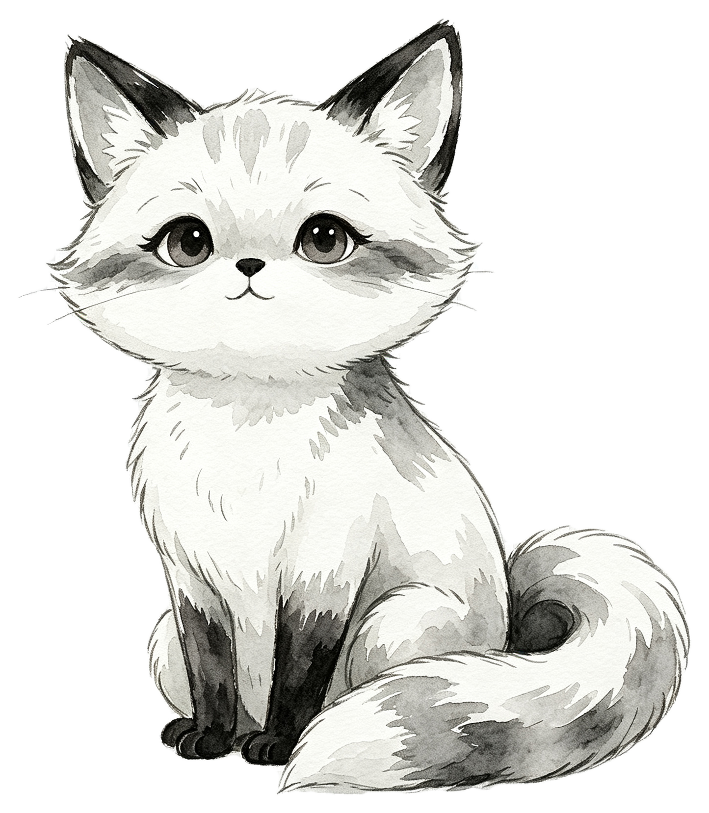
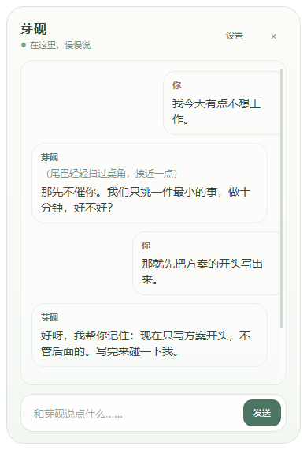
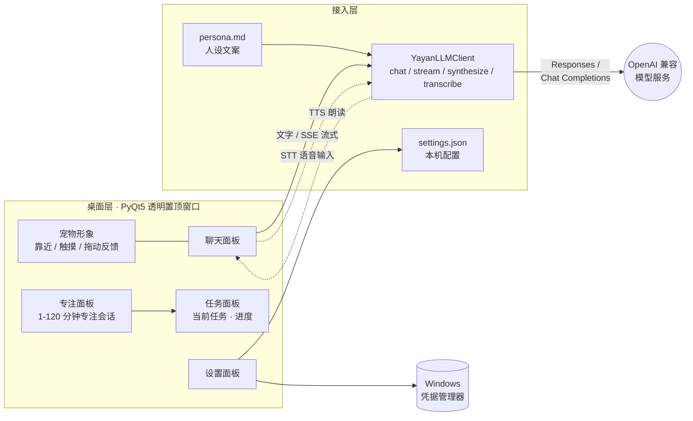

<div align="center">


# 芽砚 Yayan

**一只住在 Windows 桌面角落的水彩狐猫，陪你聊天、记任务、专注工作。**




</div>

---

## 这是什么？

芽砚不是养成游戏，也不是虚拟主播，而是一个安静的**工作陪伴伙伴**：

- 它蹲在桌面角落，靠近、触摸、拖动它会有害羞、思考、开心等动态反馈；
- 干活前跟它说一句"我不想工作"，它会帮你把任务拆到最小，陪你先做十分钟；
- 专注时它会计时、提醒、记录进度；想聊两句随时开口，支持流式回复和语音朗读。

它刻意做得**轻而小**：核心代码约两千行，四个依赖，双击即用——适合当作第一个读代码、动手改造的 AI 桌宠项目。

## 界面速览

<div align="center">



*聊天面板：自然对话、任务拆解，纸感排版。*

</div>

## 功能一览

| 能力 | 说明 |
| --- | --- |
| 🐾 桌面宠物 | 透明、无边框、置顶窗口，多种触摸反馈动画 |
| 💬 流式聊天 | OpenAI 兼容接口，支持 Responses API 与 Chat Completions 的 SSE 流式回复 |
| ⏳ 专注陪伴 | 1–120 分钟专注会话，暂停 / 继续 / 提醒，重启后可恢复 |
| 📋 任务记录 | 记录当前任务、下一步与进度，随上下文一起给模型 |
| 🎙️ 语音（可选） | 语音输入（STT）与朗读（TTS），文字与语音服务互不影响 |
| 🔒 隐私边界 | 不读你的文件、不存聊天记录，密钥保存在 Windows 凭据管理器 |
| ✏️ 可定制 | 编辑 `desktop/persona.md` 即可改人设，窗口缩放、提醒强度均可调 |

## 工作原理



- **模型接入**：任何 OpenAI 兼容服务均可（OpenAI、DeepSeek、Kimi、本地 Ollama 等），在设置页填地址、密钥、模型名即可；
- **密钥安全**：只存 Windows 凭据管理器或环境变量，不写文件、不进仓库；
- **无服务端**：单一本地进程，没有后台服务，退出即干净。

## 快速开始

要求：Windows 10/11、Python 3.10+。

在项目目录打开 PowerShell：

```powershell
py -m venv .venv
.\.venv\Scripts\python.exe -m pip install --upgrade pip
.\.venv\Scripts\python.exe -m pip install -r requirements.txt
```

双击 `Start-Yayan.cmd` 启动。右键点击芽砚打开设置；双击 `Stop-Yayan.cmd` 完全退出。

> 启动后没有窗口？查看 `output/runtime/` 里的启动日志（该目录只存本机状态，已被 Git 忽略）。

## 配置模型

在设置页填写四项：

| 设置项 | 说明 |
| --- | --- |
| API 地址 | OpenAI 或兼容服务的基础地址 |
| API 密钥 | 自动保存到 Windows 凭据管理器 |
| 模型名称 | 供应商实际提供的模型名 |
| 接口类型 | `responses` 或 `chat` |

也可以用环境变量：`OPENAI_API_KEY`、`YAYAN_LLM_MODEL`、`YAYAN_LLM_BASE_URL`、`YAYAN_API_MODE`。

> 注意：不同供应商对文字、语音识别、语音合成的支持不同——能聊天不代表也提供 Audio API。芽砚会把文字与语音错误分开处理，语音不可用不影响聊天。

## 与同类项目的不同

桌面宠物和 AI 陪伴领域有不少优秀的开源项目，芽砚的定位和它们并不相同：

| | 芽砚 Yayan | [VPet 虚拟桌宠模拟器](https://github.com/LorisYounger/VPet) | [Shimeji-ee](https://kilkakon.com/shimeji/) | [Open-LLM-VTuber](https://github.com/Open-LLM-VTuber/Open-LLM-VTuber) |
| --- | --- | --- | --- | --- |
| **定位** | AI 专注陪伴 + 轻量聊天 | 桌宠养成互动游戏 | 经典桌面精灵动画 | Live2D 语音 AI 伴侣 |
| **技术栈** | Python + PyQt5 | C# / WPF | Java | Python + Electron |
| **AI 对话** | ✅ 流式，任意 OpenAI 兼容接口 | ➖ 可选（ChatGPT 设置项） | ❌ | ✅ 多家 LLM 可切换 |
| **语音** | ➖ 可选 STT / TTS | ❌ | ❌ | ✅ 实时语音、可打断 |
| **专注 / 任务陪伴** | ✅ 专注会话 + 任务面板 | ❌（有"打工"玩法） | ❌ | ❌ |
| **部署重量** | 轻：4 个依赖，双击启动 | 轻：Steam / 安装包 | 中：需要 Java | 重：前后端 + 模型配置 |
| **二次开发** | 核心约两千行，改 `persona.md` 即换人设 | 创意工坊 MOD 生态 | XML 定义行为 | 模块化 `conf.yaml` |

**怎么选？**

- 想要丰富的动画、喂食、养成玩法 → **VPet**（创意工坊生态很强）
- 想要满屏幕乱爬的小人、海量社区形象 → **Shimeji**
- 想要 Live2D 虚拟伴侣、实时语音对话甚至直播互动 → **Open-LLM-VTuber**
- 只想要一个安静蹲在角落、能聊两句、帮你开始干活、代码简单到自己能改的伙伴 → **芽砚**

> 芽砚在动画与状态机设计上学习参考了 VPet 的开源代码（Apache 2.0），但未直接使用其代码或素材。

## 路线图

以下能力正在设计中（尚未实现）：

- 😊 情绪状态系统，与动画、对话风格联动
- 🧠 可选的长期记忆（RAG），保持"不存聊天记录"的隐私底线
- 📚 多会话管理
- 🛠️ 工具调用（Agent / MCP）
- 💡 主动对话：到你专注结束时才开口，而不是打断你

## 隐私和权限边界

- 芽砚不会自动读取、修改、移动或删除你的工作文件；
- 默认模型上下文只包含聊天内容和你主动填写的任务状态；
- API 密钥只从环境变量或 Windows 凭据管理器读取；
- 本机设置、日志、录音和任务状态位于 `output/runtime/`，不会进入 Git；
- 模型只能提出建议，不能替用户做决定。

## 项目结构

```text
assets/                  正式宠物素材
desktop/                 PyQt5 桌面程序、模型接入与人设
  main.pyw               主程序（宠物窗口、聊天/专注/任务/设置面板）
  llm_client.py          模型接入（chat / stream / synthesize / transcribe）
  chat_stream.py         SSE 流式解析
  focus_session.py       专注会话状态机
  persona.md             人设文案，改这里就能换性格
  settings.json          本机配置
Start-Yayan.cmd          启动桌面宠物
Stop-Yayan.cmd           安全退出桌面宠物
scripts/                 离线验证和素材处理工具
tests/                   聊天流与专注会话的单元测试
docs/images/             README 使用的精选截图
legacy/web-prototype/    早期网页原型，不是当前默认产品
```

## 开发与验证

```powershell
# 离线验证桌面环境与素材
.\.venv\Scripts\python.exe scripts\verify_desktop.py

# 运行单元测试
.\.venv\Scripts\python.exe -m unittest discover -s tests

# 素材处理工具需要额外依赖
.\.venv\Scripts\python.exe -m pip install -r requirements-dev.txt
```

## 许可证

本项目采用 [MIT License](LICENSE)。仓库中的角色素材也随本项目一同开放使用；如果素材的原始生成平台对输出另有约束，使用者仍需遵守相应平台条款。

## 致谢

- [VPet 虚拟桌宠模拟器](https://github.com/LorisYounger/VPet)（Apache 2.0）——动画与状态机设计的学习参考；
- 所有 OpenAI 兼容服务生态，让一只小猫接上任何大脑都成为可能。
