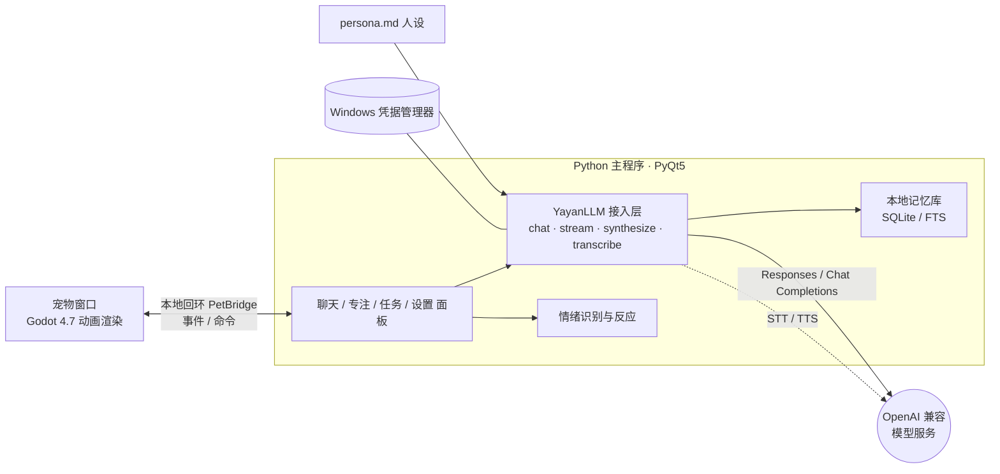

<div align="center">


# 芽砚 Yayan

**一只住在 Windows 桌面角落的水彩狐猫，陪你聊天、记任务、专注工作。**


</div>

---

## 这是什么？

芽砚不是养成游戏，也不是虚拟主播，而是一个安静的**工作陪伴伙伴**：

- 它蹲在桌面角落，靠近、触摸、拖动它会有害羞、开心、思考等动态反馈；
- 干活前跟它说一句"我不想工作"，它会帮你把任务拆到最小，陪你先做十分钟；
- 专注时它会计时、提醒、记录进度；想聊两句随时开口，支持流式回复和语音朗读；
- 它记得住你在意的事，但**是否记录由你决定**，一切只存在你本机。

它刻意做得**轻而小**：双击即用，四个依赖，核心代码约两千行——适合当作第一个读代码、动手改造的 AI 桌宠项目。

## 界面速览

<div align="center">


*聊天面板：自然对话、任务拆解，纸感排版。*

</div>

## 功能一览

| 能力 | 说明 |
| --- | --- |
| 🐾 桌面宠物 | 透明、无边框、置顶窗口；Godot 动画（走动、转身、眨眼、躺下、反应动作），可拖动、可点击 |
| 💬 流式聊天 | OpenAI 兼容接口，支持 Responses API 与 Chat Completions 的 SSE 流式回复 |
| 😊 情绪状态 | 从对话中识别情绪，联动宠物动画与回复语气；识别失败会自动跳过，不打断聊天 |
| 🧠 长期记忆 | 分级、**需你确认**的本地记忆库（SQLite + 全文检索）；设置里可查看、导出或清空 |
| 🗂️ 会话续接 | 对话本地保存，重启后自动接续最近的对话 |
| ⏳ 专注陪伴 | 1–120 分钟专注会话，暂停 / 继续 / 提醒，重启后可恢复 |
| 📋 任务记录 | 记录当前任务、下一步与进度，随上下文一起给模型 |
| 🎙️ 语音（可选） | 语音输入（STT）与朗读（TTS），文字与语音服务互不影响 |
| 🔒 隐私边界 | 不读你的文件；聊天与记忆只存本机，密钥保存在 Windows 凭据管理器 |
| ✏️ 可定制 | 编辑 `desktop/persona.md` 即可改人设，窗口缩放、提醒强度均可调 |

## 快速开始

**要求**：Windows 10/11、Python 3.10+。仅此一项，**不需要单独安装 Godot**。

1. 安装 Python 3.10+（安装时勾选 **Add python.exe to PATH**）；
2. 在项目目录**双击 `Start-Yayan.cmd`**。

首次运行会自动完成三件事（需要联网，仅这一次）：

| 步骤 | 说明 |
| --- | --- |
| 建虚拟环境 | 自动创建 `.venv` 并安装 `requirements.txt` 里的依赖 |
| 装动画渲染包 | 自动下载预编译的 Godot 渲染包（约 300MB）到 `output/godot/` |
| 启动 | 拉起主程序，宠物出现在屏幕右下角 |

3. **配置模型**：右键点击芽砚 → 「设置」，填入 API 地址、密钥、模型名（见下节）。

退出：右键芽砚 → 「退出芽砚」，或双击 `Stop-Yayan.cmd`。

> 启动后没看到宠物？查看 `output/runtime/` 下的日志：`bootstrap.log`（环境准备）、`desktop-startup.log`（主程序）、`godot-stdout.log`（动画渲染）。这些目录只存本机状态，已被 Git 忽略。

## 配置模型（API）

在设置页填写四项，保存即可：

| 设置项 | 说明 |
| --- | --- |
| API 地址 | OpenAI 或兼容服务的基础地址（Base URL） |
| API 密钥 | 自动保存到 Windows 凭据管理器，不落盘、不进仓库 |
| 模型名称 | 供应商实际提供的模型名 |
| 接口类型 | `responses` 或 `chat`（Chat Completions 兼容模式） |

任何 OpenAI 兼容服务均可（OpenAI、DeepSeek、Kimi、本地 Ollama 等）。
也可以用环境变量覆盖：`OPENAI_API_KEY`、`YAYAN_LLM_MODEL`、`YAYAN_LLM_BASE_URL`、`YAYAN_API_MODE`。

> 注意：不同供应商对文字、语音识别、语音合成的支持不同——能聊天不代表也提供 Audio API。芽砚会把文字与语音错误分开处理，**语音不可用不影响聊天**。

## 动画渲染器与回退

宠物动画由 **Godot 渲染器**提供；它是以一个独立可执行程序（`YayanPet.exe` + `YayanPet.pck`）随 GitHub Release 分发的，所以你不需要安装 Godot。

- 渲染包就位时：用 Godot 播放完整动画；
- 渲染包缺失或启动失败时：**自动回退**到 PyQt 静态立绘（仍有呼吸、眨眼、拖动），聊天与专注功能完全不受影响；
- 想强制用静态立绘：设置环境变量 `YAYAN_SKIP_RENDERER_DOWNLOAD=1` 后再启动；
- 想切换渲染器：编辑 `desktop/settings.json` 里的 `"pet_renderer"`（`godot` 或 `pyqt`）。

## 常见问题

| 现象 | 处理 |
| --- | --- |
| 双击后一闪而过 | 看 `output/runtime/bootstrap.log`；多半是没装 Python 或未勾选 PATH |
| 宠物只有静态立绘 | 渲染包没下下来。删除 `output/godot/` 后重新双击 `Start-Yayan.cmd` 触发重下 |
| 下载停在原地 | 网络问题，可直接从 GitHub Releases 手动下载 `yayan-renderer-win64.zip`，解压到 `output/godot/` |
| 设置了模型仍不回复 | 检查「接口类型」是否与供应商匹配（`responses` 还是 `chat`），以及 Base URL 是否带 `/v1` |
| 想彻底重来 | 删除 `.venv/` 与 `output/`，重新双击 `Start-Yayan.cmd` |

## 工作原理



- **模型接入**：任何 OpenAI 兼容服务均可，在设置页填 地址 / 密钥 / 模型名即可；
- **密钥安全**：只存 Windows 凭据管理器或环境变量，不写文件、不进仓库；
- **渲染解耦**：Godot 只负责画面，通过本地回环的 `PetBridge` 收发事件与命令；Godot 崩溃不影响聊天与记忆（进程独立）；
- **无服务端**：单一本地进程，没有后台服务，退出即干净。

## 与同类项目的不同

桌面宠物和 AI 陪伴领域有不少优秀的开源项目，芽砚的定位和它们并不相同：

| | 芽砚 Yayan | [VPet 虚拟桌宠模拟器](https://github.com/LorisYounger/VPet) | [Shimeji-ee](https://kilkakon.com/shimeji/) | [Open-LLM-VTuber](https://github.com/Open-LLM-VTuber/Open-LLM-VTuber) |
| --- | --- | --- | --- | --- |
| **定位** | AI 专注陪伴 + 轻量聊天 | 桌宠养成互动游戏 | 经典桌面精灵动画 | Live2D 语音 AI 伴侣 |
| **技术栈** | Python + PyQt5 + Godot | C# / WPF | Java | Python + Electron |
| **AI 对话** | ✅ 流式，任意 OpenAI 兼容接口 | ➖ 可选（ChatGPT 设置项） | ❌ | ✅ 多家 LLM 可切换 |
| **语音** | ➖ 可选 STT / TTS | ❌ | ❌ | ✅ 实时语音、可打断 |
| **专注 / 任务陪伴** | ✅ 专注会话 + 任务面板 | ❌（有"打工"玩法） | ❌ | ❌ |
| **部署重量** | 轻：4 个依赖，双击启动 | 轻：Steam / 安装包 | 中：需要 Java | 重：前后端 + 模型配置 |
| **二次开发** | 核心约两千行，改 `persona.md` 即换人设 | 创意工坊 MOD 生态 | XML 定义行为 | 模块化 `conf.yaml` |

**怎么选？**

- 想要丰富的动画、喂食、养成玩法 → **VPet**（创意工坊生态很强）
- 想要满屏幕乱爬的小人、海量社区形象 → **Shimeji**
- 想要 Live2D 虚拟伴侣、实时语音对话甚至直播互动 → **Open-LLM-VTuber**
- 只想要一个安静蹲在角落、能聊两句、帮你开始干活、代码简单到自己能改的伙伴 → **芽砚**

> 芽砚在动画与状态机设计上学习参考了 VPet 的开源代码（Apache 2.0），但未直接使用其代码或素材。

## 路线图

以下能力仍在设计中（尚未实现）：

- 💡 主动对话：到你专注结束时才开口，而不是打断你
- 🛠️ 工具调用（Agent / MCP）
- 🎨 更多动作与形象

## 隐私和权限边界

- 芽砚不会自动读取、修改、移动或删除你的工作文件；
- 聊天记录与长期记忆**只保存在本机** SQLite（`output/runtime/`），不上传、不进 Git；设置里可查看、导出或清空记忆；
- 长期记忆是**可选**的，采用分级策略：低风险信息也需要**你确认**后才生效，高风险个人信息不会自动保存；
- API 密钥只从环境变量或 Windows 凭据管理器读取；
- 模型只能提出建议，不能替用户做决定。

## 项目结构

```text
assets/                   宠物素材：立绘、图标（动画帧与源视频见 Release 附件）
desktop/                  PyQt5 桌面程序、模型接入、情绪与记忆
  main.pyw                 主程序（宠物窗口、聊天/专注/任务/设置面板）
  llm_client.py            模型接入（chat / stream / synthesize / transcribe）
  chat_stream.py           SSE 流式解析
  focus_session.py         专注会话状态机
  conversation_manager.py  会话管理与持久化
  memory_store.py          本地记忆库（SQLite + FTS）
  memory_search.py         记忆检索
  memory_extractor.py      记忆抽取
  memory_policy.py         记忆策略（分级、需确认）
  emotion_service.py       情绪识别服务
  emotion_rules.py         情绪规则
  emotion_policy.py        情绪 → 反应策略
  event_bus.py             事件总线
  pet_bridge.py            Python ↔ Godot 本地通信
  instance_guard.py        单实例守卫
  contracts.py             消息契约
  persona.md               人设文案，改这里就能换性格
  settings.json            本机配置
godot/                    Godot 4.7 宠物渲染器（动画播放、走动、拖动）
scripts/                  启动器与离线验证 / 素材处理工具
tests/                    单元测试
docs/                     设计文档与精选截图
Start-Yayan.cmd           一键启动（自动建环境、补渲染包）
Stop-Yayan.cmd            安全退出
```

## 开发与验证

```powershell
# 一键环境准备（建 venv + 装依赖 + 补渲染包）
py -3 scripts\bootstrap_yayan.py

# 离线验证桌面环境与素材
.\.venv\Scripts\python.exe scripts\verify_desktop.py

# 运行单元测试
.\.venv\Scripts\python.exe -m unittest discover -s tests
```

需要重新编译 Godot 渲染器（改了动画或场景）时：安装 [Godot 4.7.x](https://godotengine.org/download) 与其对应导出模板，把动画帧放到 `assets/yayan-*`（或 `godot/assets/`）后运行 `scripts/build_godot.ps1`。日常使用**不需要**这一步。

## 许可证

本项目采用 [MIT License](LICENSE)。仓库中的角色素材也随本项目一同开放使用；如果素材的原始生成平台对输出另有约束，使用者仍需遵守相应平台条款。

## 致谢

- [VPet 虚拟桌宠模拟器](https://github.com/LorisYounger/VPet)（Apache 2.0）——动画与状态机设计的学习参考；
- [Godot Engine](https://godotengine.org)（MIT）——宠物动画渲染；
- 所有 OpenAI 兼容服务生态，让一只小猫接上任何大脑都成为可能。
